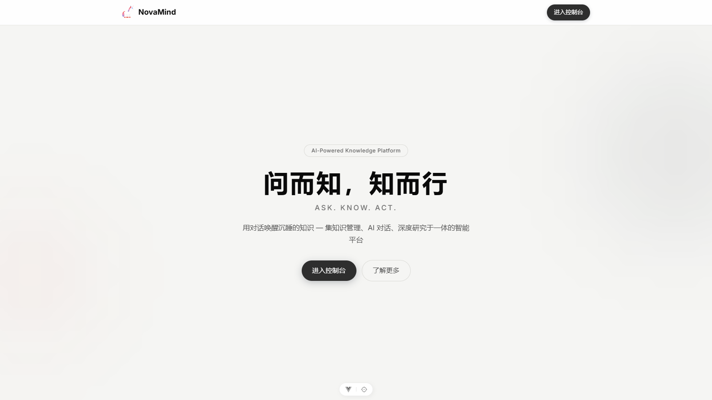
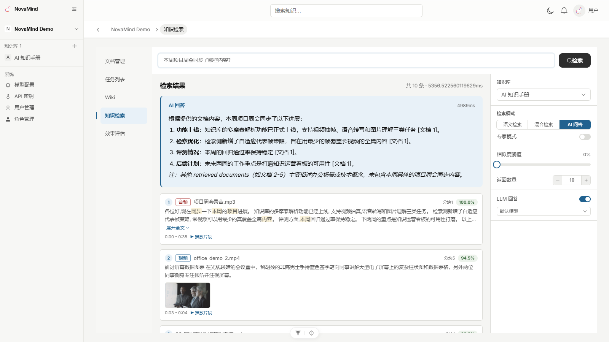
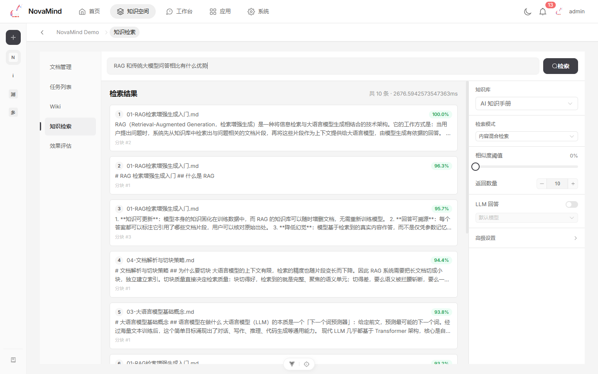
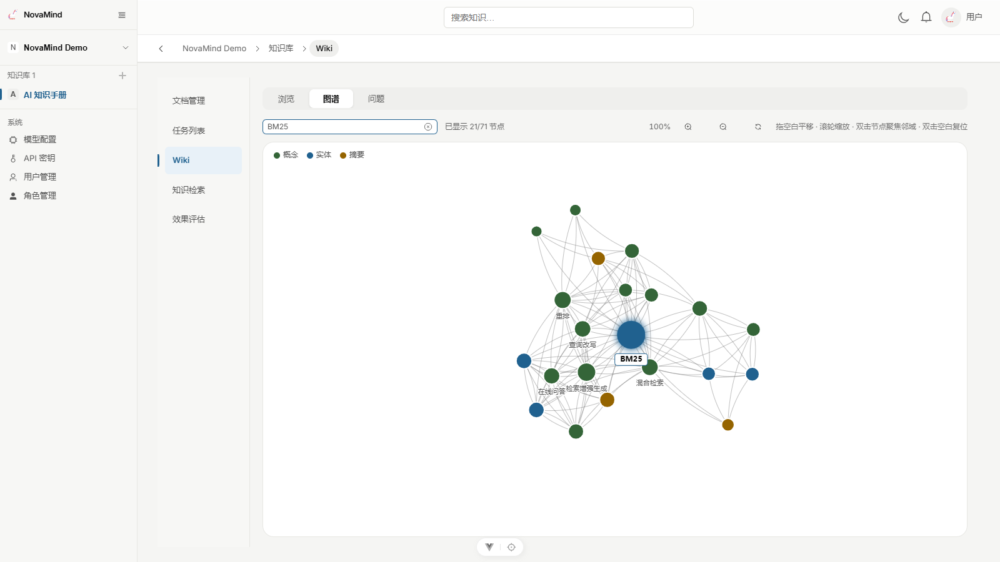
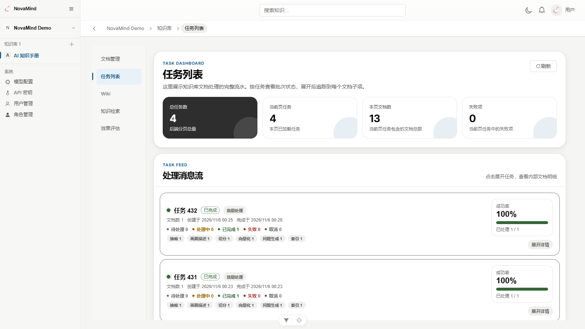
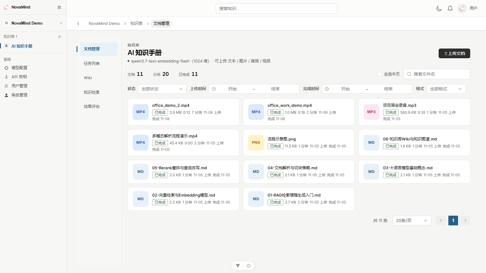
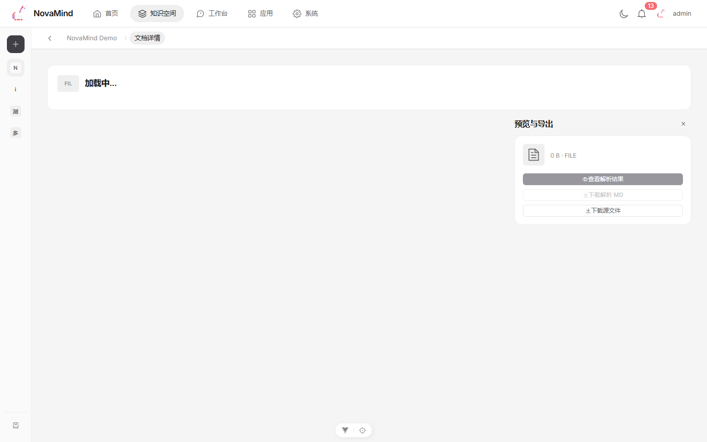
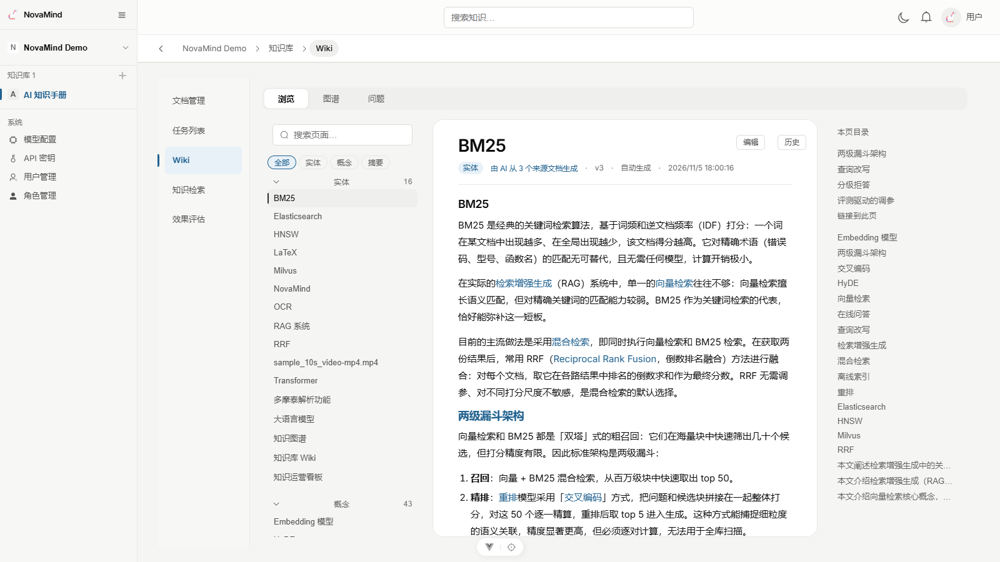

<div align="center">

# 🧠 NovaMind

**A standalone knowledge service: knowledge bases · multimodal parsing · retrieval & wiki · MCP/OpenAI access for any agent host**

[](./LICENSE)
[](https://github.com/SpaceshiptoMoon/NovaMind/actions/workflows/ci.yml)
[](./backend/pyproject.toml)
[](./backend)
[](./frontend)
[](./frontend)
[](./docker-compose.yml)

**Documents in (PDF / scans / images / audio / video) — cited answers, structured wikis, and research reports out.**

English | [简体中文](./README.md)

</div>

<p align="center">
  
</p>

---

<div align="center">

| Retrieval with citations | Hybrid retrieval · 9 modes |
| :---: | :---: |
|  |  |
| **KB Wiki · knowledge graph** | **Document pipeline · task tracking** |
|  |  |

</div>

<details open>
<summary><b>📕 Table of Contents</b></summary>

- [Quick try](#quick-try)
- [What it is](#what-it-is)
- [Core capabilities](#core-capabilities)
- [Document processing pipeline](#document-processing-pipeline)
- [Knowledge-base Wiki](#knowledge-base-wiki)
- [Who it's for](#who-its-for)
- [Compared with mainstream options](#compared-with-mainstream-options)
- [Tech stack](#tech-stack)
- [Quick start](#quick-start)
  - [Option 1: one-command deploy](#option-1-one-command-deploy)
  - [Option 2: manual Docker deploy](#option-2-manual-docker-deploy)
  - [Option 3: local development](#option-3-local-development)
- [Access points](#access-points)
- [Architecture overview](#architecture-overview)
- [Repository layout](#repository-layout)
- [Modules](#modules)
- [Configuration](#configuration)
- [Model integration](#model-integration)
- [Security](#security)
- [Testing & quality checks](#testing--quality-checks)
- [FAQ](#faq)
- [Project status](#project-status)
- [Documentation](#documentation)
- [Open-source collaboration](#open-source-collaboration)
- [License](#license)

</details>

---

## Quick try

```bash
git clone https://github.com/SpaceshiptoMoon/NovaMind.git
cd NovaMind
bash deploy.sh    # Windows PowerShell: powershell -ExecutionPolicy Bypass -File deploy.ps1
```

Once deployed, open `http://localhost` and sign in as `admin`; the initial password is in `ADMIN_PASSWORD` in the root `.env`. The script takes care of the environment check, secret generation, DeepDoc / speech model downloads and the health check.

> [!TIP]
> Linux self-hosting needs `vm.max_map_count >= 262144` set first (an Elasticsearch kernel requirement) — see the prerequisites in [Quick start](#quick-start). Manual Docker deploy and local development are covered in the same section.

---

## What it is

Many knowledge-base projects only cover the "upload a document and chat" segment. NovaMind covers a more complete workflow:

- From spaces, knowledge bases, and document upload to **multimodal parsing** (text / image / video / audio), splitting, vectorization, and indexing
- From retrieval to knowledge-enhanced generation, and on to evaluation & operations loops
- From a private knowledge base to an open knowledge service via MCP and an OpenAI-compatible gateway
- From building capabilities to evaluation test sets, manual review, and result export
- From raw documents to auto-generated structured wikis, knowledge graphs, and quality linting

Real team knowledge comes in far more shapes than text: product demo videos, review meeting recordings, architecture diagram screenshots, scanned contracts… — they should land in the **same** retrieval system instead of being scattered across network drives and chat logs.

Three dead ends that keep recurring:

1. **"I remember a video that covered this" — and it can't be found.** Training recordings, product demos and review recordings either cannot be uploaded at all in most knowledge-base products, or only their filename is extracted. NovaMind breaks videos down to the frame level (per-frame VLM understanding) and audio down to timestamps (local whisper transcription), and generates a chaptered narrative document for each video — "the return process was demonstrated at which minute" gets a coherent answer with a timeline, instead of stitched frame descriptions.
2. **Scans, formulas and tables come out as garbage or blank.** Generic solutions only extract the PDF text layer, so image-based PDFs come out empty. NovaMind ships the DeepDoc parsing engine: layout analysis + per-span text layer fused with OCR + formula recognition + table structure restoration — parsing quality sets the floor for RAG.
3. **Abandoned two months after going live: "the answers feel bad, but nobody can say where".** A knowledge base without a feedback loop rots silently. NovaMind attributes failures along two tracks: four-way attribution of failed live Q&A (content gap / retrieval failure / stale content / permission boundary), and five-stage, 15-category attribution of failed evaluation cases (source data / parsing & ingestion / retrieval / generation / question side; multi-level replay pinpoints exactly which link dropped something that should have been recalled); gaps convert to test sets in one click, and the quality baseline batch-compares weekly and alerts on regressions in key metrics — whether a fix worked is decided by the data.

On top of that, NovaMind covers the complete workflow: spaces / knowledge bases / permissions → multimodal parsing → splitting → vectorization → hybrid retrieval → knowledge enhancement & evaluation → operations loop → automatic structured Wiki and knowledge graph.

If you want more than a document cabinet — a knowledge service that organizes knowledge, continuously verifies its own effectiveness, and can be consumed by any agent host via MCP/OpenAI — that is exactly where NovaMind is positioned.

## Core capabilities

### 📚 Knowledge-base engine

- **Spaces & knowledge bases**: multi-space isolation, member collaboration (OWNER / ADMIN / EDITOR / VIEWER roles), per-KB parsing config, full document lifecycle
- **Hybrid retrieval**: vector, BM25, hybrid, rerank, query rewriting, and multi-level fallbacks — 9 retrieval modes
- **Hypothetical-question augmentation**: optionally generate hypothetical questions per chunk and index them as question vectors to improve recall
- **KB evaluation & failure attribution**: test-set management, automated evaluation, manual scoring, report export; distill QA messages into test sets in one click, and compare two reports to spot per-case regressions. Failed cases are auto-attributed across five stages (source data / parsing / retrieval / generation / query) into 15 root-cause categories via multi-level replay + LLM judging (replay-first to control cost); the report page shows the root-cause distribution and hotspot documents, and source/parsing issues automatically become ops todos

<p align="center">
  
</p>

### 📄 Multimodal document parsing

- **Text documents**: PDF (DeepDoc full mode with per-span text layer + OCR fusion, or lightweight plain mode), DOCX, Excel (XLS / XLSX), PPT (PPT / PPTX), TXT, MD, CSV, HTML, JSON, EPUB, email (EML / MSG), OFD
- **Image understanding**: VLM-generated descriptions, or DeepDoc OCR for in-image text
- **Video parsing**: 8 strategy presets (fixed-interval / scene-change / deduplicated sampling × per-frame / grouped / frame-sequence pseudo-video / native video clips / adaptive representative frames — coarse sampling + farthest-point selection, fewest frames covering the whole video), audio-track ASR fusion, LLM step synthesis, dual-anchor timeline alignment
- **Video narrative document**: after parsing, fragment frame descriptions can be synthesized into a chaptered coherent narrative (whole-video synopsis + chapter timeline), coexisting with the fragment chunks; QA auto-attaches the matched chapter summary — "what is this video about" gets a coherent answer instead of stitched fragments
- **Audio transcription**: local **faster-whisper** by default (free, no API key, model pre-downloaded at deploy time); switchable to cloud ASR (OpenAI Whisper / DashScope Paraformer)
- **Formulas & tables**: PDF formula recognition (pix2text-mfr INT8), table structure restoration with inline HTML
- **Resumable pipeline**: three-level content fingerprints (parse / split / embed) — retries reuse already-paid artifacts on fingerprint match; config changes cascade-invalidate downstream

<p align="center">
  
</p>

### 🤖 Knowledge enhancement & open access

- **Knowledge service endpoints**: standard MCP server (kb_search retrieval tool) + OpenAI-compatible gateway (/v1/chat/completions) + API-key gating — Claude Code, Cursor, or any agent host can plug into your knowledge base directly; the three surfaces share one config, one key, and the creator's permission chain. Contracts and parameters: [external API reference](./docs/agent/api-reference.md)
- **Claude Code skill package**: the `novamind-kb` skill — configure once (api_key + space_id + kb_id), then ask about the knowledge base in natural language; MCP/script dual channel (same key as the MCP server), see [`docs/skill-package/novamind-kb/`](./docs/skill-package/novamind-kb/)
- **Citation-level tracing**: retrieval results locate the exact source chunk; PDF citations jump to the exact page with bbox-level highlighting of the cited region; matched video chunks carry the coherent chapter narrative summary

<p align="center">
  
</p>

### 🛡 Platform

- **Task system**: ARQ-based async task orchestration — batch processing, per-step progress, cancel / retry, zombie-task cleanup, crash recovery for orphaned tasks
- **Realtime notifications**: WebSocket push with polling fallback; parse completion / failure / cancel events
- **Knowledge operations platform**: an inbox-style ops page whose top module bar (Dashboard / QC / Disposition / Verification / Ledger) is the platform skeleton — 4-dimension health report (retrieval / freshness / feedback / order, transparent rules), a unified todo center (gaps / due reviews / low-score feedback / eval-attribution, four sources ranked by impact; ignoring requires a reason and is persisted & undoable), an event ledger plus action registry (single source of truth, traceable dispositions), cold-start onboarding (three checks: retrieval readiness / content / behavioral data), and quality-baseline regression alerts
- **Multi-model access**: LLM / Embedding / Rerank / VLM / ASR — anything OpenAI-compatible plugs in; connection testing and encrypted key storage

## Document processing pipeline

Every document flows through one unified pipeline; the four modality branches share the tail (split → embed → hypothetical questions → ES indexing):

```text
Upload (MinIO original + hash dedup)
  └▶ ARQ async task
       ├─ text     DeepDoc / generic readers ────────┐
       ├─ image    VLM description / OCR ────────────┤
       ├─ video    frame sampling → VLM per frame ───┼─▶ split → Embedding
       │           └▶ narrative synthesis (optional, chaptered coherent doc)
       └─ audio    local faster-whisper / cloud ASR ─┘     → hypothetical questions (optional)
                                                             → ES vector + full-text index
                                                             → Wiki generation (when KB enabled)
```

Pipeline reliability design:

- **Three-level content fingerprints** (parse / split / embed): retries reuse snapshots on fingerprint match, skipping expensive VLM / OCR / ASR / embedding calls; parsing or splitting config changes cascade-invalidate downstream
- **Per-step progress**: every step (parsed / split / embedded / indexed…) is persisted in real time; the task list visualizes execution traces, failures pin-point to the exact step
- **Transaction safety**: DB writes use SAVEPOINTs; queue jobs bind atomically to task rows; orphaned tasks are recovered automatically at startup after a crash
- **Full-text retention**: parsed text lands in MinIO immediately — chunking or embedding failures never lose parse results

## Knowledge-base Wiki

A traditional KB answers "where is this passage"; the Wiki answers "what is the full picture of this topic". NovaMind auto-generates a structured wiki from KB content (WeKnora-aligned design):

```text
KB documents ──parsed──▶ Wiki generation task (LLM planning + generation)
                            ├─ index pages: global navigation
                            ├─ topic pages: topic aggregation (multi-source merge)
                            └─ summary pages: per-document summaries
                                 │
                                 ├─▶ [[link]] resolution + knowledge-graph construction
                                 ├─▶ ES sync (wp-* chunks, retrieval boost 1.3x)
                                 └─▶ quality linting (six issue classes + health score)
```

<p align="center">
  
</p>

- **Frontend visualization**: wiki browser (page rendering + backlinks), force-directed knowledge graph (topic linking, node highlighting), issues panel (orphan pages / dead links / stale references / empty content and more — fix or ignore one by one, health score 0-100)
- **Generated pages sync into the ES retrieval index** with boosted ranking — QA can hit wiki entries directly
- **Agent integration**: external agents can read wiki pages via MCP tools — "overview first, details second"
- **Lifecycle management**: document updates / deletions reconcile automatically (reparse merges updates, source deletion retracts pages) — no dangling references

<p align="center">
  
</p>

## Who it's for

- Teams or organizations that need an internal knowledge base with multi-space isolation and member permissions
- Mixed document formats: scanned PDFs, images, meeting recordings, training videos — all in one retrieval system
- A complete, observable, recoverable document pipeline: upload → parse → split → embed → retrieve → QA
- Chaining knowledge governance, retrieval quality, and external agent-host consumption into one workflow instead of scattered tools
- An evaluation system (test sets, auto eval, manual scoring) to verify KB effectiveness
- Willing to run some infrastructure (MySQL, Redis, Elasticsearch, MinIO) in exchange for completeness and freedom

## Compared with mainstream options

The table reflects each project's publicly announced capabilities as of 2026-11. This space moves fast — when choosing, defer to each project's official docs.

| Option | Their strengths | Where NovaMind differs |
| --- | --- | --- |
| **RAGFlow** | Equally strong document parsing (same DeepDoc lineage), fine-grained chunk templates, large community | Video / audio modalities (8 strategy presets + narrative documents), evaluation regression gate, two-track attribution operations loop (four-way live + 15-category evaluation) |
| **Dify** | Plugin ecosystem, workflow orchestration, LLMOps, easy onboarding | Parsing depth, Wiki subsystem, evaluation & operations loop, video modality — a different niche: it is an application orchestration platform where the knowledge base is an accessory |
| **WeKnora** | Wiki design (which NovaMind aligns with), big-vendor ecosystem integration | Video depth, five-stage attribution + gap-to-test-set flywheel + regression alerts, evaluation regression baseline |
| **MaxKB / AnythingLLM** | Single-container deployment, works out of the box | Parsing depth, multimodality, evaluation, operations — a capability gap, paid for with a heavier deployment |
| **Build your own (LangChain / LlamaIndex)** | Flexible, fits the business exactly | A framework is not a product: task orchestration, resumable pipelines, per-step progress, permissions and evaluation all have to be built yourself — NovaMind gives them out of the box |

**What is defensible is completeness, not a feature list.** Anyone can extract frames, but "8 strategy presets + adaptive representative-frame calibration + audio-track transcription alignment + narrative synthesis + auto-attached chapter summaries in QA + three-level fingerprint resumption" is one complete engineering chain; and the attribution criteria (the five-stage, 15-category decision tree on the evaluation side; threshold-lowered replay on the live side to tell content gaps from retrieval failures) were calibrated on real failure cases — designs can be copied, criteria are hard to copy.

**The boundaries, stated just as honestly:**

- **Deployment weight is a real barrier**: MySQL + Redis + Elasticsearch + MinIO — four pieces of infrastructure, a slower start than single-container options; what it buys is that video / audio / scans are not turned away at the door
- **Community and ecosystem** are smaller than Dify / RAGFlow: plugins, templates and community accumulation can't compete — the differentiation plays depth, not breadth
- **Breadth of parsing formats** is behind dedicated parsing services (hundreds of formats): NovaMind takes the "go deep on common formats" route

## Tech stack

| Category | Tech |
| --- | --- |
| Backend | FastAPI, Python 3.12, SQLAlchemy, Pydantic |
| Frontend | Vue 3, TypeScript, Vite, Pinia, Vue Router, Element Plus, ECharts |
| Database | MySQL 8.4 |
| Cache / Queue | Redis 7, ARQ (async tasks) |
| Search engine | Elasticsearch 9.3 (vector + BM25 hybrid retrieval) |
| Object storage | MinIO |
| Document parsing | DeepDoc (OCR / layout analysis / table restoration / formula recognition), pypdf, python-docx, … |
| Multimodal models | VLM (image / video-frame understanding), faster-whisper (local ASR), cloud ASR |
| Extension protocol | MCP (Model Context Protocol) |
| Deployment | Docker Compose, Nginx, Supervisord |

## Quick start

> [!IMPORTANT]
> **Prerequisites common to all three options**:
>
> - **On Linux self-hosting you must set `vm.max_map_count`**: Elasticsearch requires `vm.max_map_count >= 262144`; most Linux distributions default to 65530, which makes the ES container exit immediately on boot (log: `max virtual memory areas vm.max_map_count [...] is too low`). This applies to all three options whenever Elasticsearch runs in Docker.
>   ```bash
>   sudo sysctl -w vm.max_map_count=262144              # temporary (lost on reboot)
>   echo 'vm.max_map_count=262144' | sudo tee -a /etc/sysctl.conf  # permanent
>   ```
>   Docker Desktop (macOS / Windows) already handles this inside its Linux VM — no action needed; the WSL2 kernel default is already above this floor (measured 1048576), so no action is needed there either.
> - **Prefer the HTTPS clone URL** (no SSH key setup needed): `git clone https://github.com/SpaceshiptoMoon/NovaMind.git`; use `git clone git@github.com:SpaceshiptoMoon/NovaMind.git` only if you have an SSH key configured.
> - **About the MinIO image**: the official image has been taken down — the MinIO community edition has been source-only since 2025-10, `minio/minio` was removed from Docker Hub around 2026-09 (per third-party reports), and `quay.io/minio/minio` returns 401 to anonymous access (measured 2026-11; a public control repository responds normally). Neither logging in, a proxy, nor `registry-mirrors` accelerators help. `docker-compose.yml` therefore uses by default the image Bitnami built from the MinIO 2025-07-23 source — nothing extra to do. This MinIO version ships without a web console. **Upgrading an older deployment that ran the official image**: the old files in the data volume are owned by root, while the Bitnami image runs as a non-root user and cannot write them — run the command below once before starting (the `redis` image is already pulled by the deploy and is used only for its `chown`):
>   ```bash
>   docker run --rm -v novamind_minio-data:/data redis:7.4.9-alpine chown -R 1001:1000 /data
>   ```
>   To switch back to the official image or a self-hosted copy, override the `minio` service's `image` in `docker-compose.override.yml` (already in `.gitignore`) and restore `command: server /data --address ":9005"` and the volume `minio-data:/data`.
> - **The Elasticsearch image lives on `docker.elastic.co`**: Docker Hub `registry-mirrors` accelerators do not cover it. If the pull fails, configure a proxy for the Docker daemon, or pull manually and `docker tag` under the same image name compose expects.

### Option 1: one-command deploy

Recommended for a first run.

```bash
# Linux / macOS / Git Bash
bash deploy.sh

# Windows PowerShell (the default execution policy Restricted blocks script execution — use this command)
powershell -ExecutionPolicy Bypass -File deploy.ps1
```

The deploy script will automatically:

- Check the Docker and Docker Compose environment
- Generate `.env` from `.env.example`
- Generate random passwords, secrets, and the initial admin password
- Create `backend/src/setting/yaml_config/yaml/default.yaml` (the single backend config file)
- Build and start the full stack
- Download DeepDoc models at deploy time (OCR / layout / table / paragraph-merge XGBoost / formula recognition pix2text-mfr, several hundred MB total) into `backend/.cache/deepdoc`, mounted into the container via a compose volume (`/app/.cache/deepdoc`) so they survive container recreation; defaults to the `hf-mirror.com` mirror (`HF_ENDPOINT` overridable). **A failure here does not abort the deploy** — parsing degrades gracefully (formula recognition skipped, DeepDoc full mode unavailable) and you can retry later per the script's warning
- Download the local speech model (the tier follows the GPU: `large-v3` (~3GB) when the container can use a GPU, otherwise only `small` (~460MB), which runs on the CPU; use `--model` to pick another tier) into `backend/.cache/faster-whisper` (mounted as `/app/.cache/faster-whisper`) — audio documents transcribe locally by default; if the model is missing, audio parsing fails; retry per the script's hint
- Poll `http://localhost/health` for a health check

After deploy, the initial admin password is in `ADMIN_PASSWORD` in the root `.env`; **the default username is `admin`**.

> [!NOTE]
> Path to a first usable state after login: **configure the two required model types — LLM and Embedding — on the "Model Management" page** (OpenAI-compatible protocol; base_url + API key, with connection testing — see [Model integration](#model-integration)) → create a space (pick the space's Embedding model in the creation form) → create a knowledge base → upload documents and **trigger parsing manually from the document list page** (upload stores only; parsing is not automatic) → search and ask AI questions on the search page. Document parsing fails without an Embedding model; AI answering is unavailable without an LLM.

Requirements:

- Docker 20.10+ (on Windows, Docker Desktop must be running)
- Docker Compose V2+
- One-command deploy via `deploy.sh` needs a working `python` or `python3` command on the host the first time it generates `.env` (to generate random secrets; the script probes `python` then `python3`, and offers an alternative when neither works). `deploy.ps1` has no such dependency
- At least 2 CPU cores / 4 GB RAM / 30 GB disk (measured: images ≈ 7 GB; models ≈ 3.2 GB with a GPU, ≈ 0.7 GB without; plus reclaimable build cache — `docker builder prune`. Elasticsearch uses a 512MB JVM heap by default; tune via `ES_JAVA_OPTS` in `.env`. The `--build` phase peaks higher — close other memory-heavy apps on small machines)
- For video parsing, local speech transcription, or DeepDoc full mode, 4 cores / 8 GB+ recommended
- Local models (speech transcription, DeepDoc document parsing) run on the CPU inside the container by default; on a machine with an NVIDIA GPU the deploy scripts detect it automatically and enable GPU acceleration — see [Optional: accelerate local models with an NVIDIA GPU](#optional-accelerate-local-models-with-an-nvidia-gpu)

Common commands:

```bash
bash deploy.sh status
bash deploy.sh logs      # follows the app container only; add services to follow more (e.g. docker compose logs -f mysql)
bash deploy.sh update
bash deploy.sh stop
bash deploy.sh clean   # ⚠️ removes ALL data volumes (knowledge bases, documents, user data are lost); interactive confirmation included
```

```powershell
.\deploy.ps1 status
.\deploy.ps1 logs
.\deploy.ps1 update
.\deploy.ps1 stop
.\deploy.ps1 clean   # ⚠️ same as above — removes all data volumes
```

### Option 2: manual Docker deploy

If you prefer to control config files and passwords yourself:

```bash
git clone https://github.com/SpaceshiptoMoon/NovaMind.git
cd NovaMind

cp .env.example .env
cp backend/src/setting/yaml_config/yaml/default.example backend/src/setting/yaml_config/yaml/default.yaml

docker compose up -d --build
```

> [!WARNING]
> **After `cp .env.example .env` you MUST edit `.env` and replace every `your-*` placeholder before starting**, otherwise:
>
> - The `ADMIN_PASSWORD` placeholder contains no uppercase letter / digit / special character. The first boot succeeds (with a weak password), but **the second restart enters a container crash loop** because the backend enforces password strength on the reset path. Admin password requirements: 8–30 chars with at least one uppercase letter, one lowercase letter, one digit, and one special character.
> - `SECRET_KEY` / `ENCRYPTION_KEY` placeholders are publicly known values from this repo — leaving them unchanged lets anyone forge JWTs and decrypt stored model API keys.
>
> Variables to replace: `MYSQL_ROOT_PASSWORD`, `MINIO_ROOT_USER`, `MINIO_ROOT_PASSWORD`, `SECRET_KEY`, `ENCRYPTION_KEY`, `ADMIN_PASSWORD`.

Notes:

- `.env` holds infrastructure passwords and backend secrets (the single secret source)
- `default.yaml` is the single backend config file, mounted read-only into the container; `*.yaml` files are not baked into the image (only `*.example` templates are), so local real secrets never leak into image layers. Deploy-time differences (`DB_HOST=mysql` etc.) are injected explicitly by the compose `app.environment` block — `.env` holds credentials only
- Option 2 skips the deploy script's model download step, so two model groups are missing after first boot:
  - **DeepDoc models missing**: parsing degrades (formula recognition skipped, full mode unavailable, `/health/detailed` shows degraded). Download manually:
    ```bash
    docker compose run --rm --no-deps --user 0 \
      -e PYTHONPATH=/app/src \
      app python -m novamind.engines.document.integrations.deepdoc prepare --include-text-concat --include-formula
    ```
  - **Local speech model missing**: audio parsing fails (unless a cloud ASR is explicitly selected). Download manually (the tier is chosen exactly as at runtime, by whether the container can use a GPU):
    ```bash
    docker compose run --rm --no-deps --user 0 \
      -e PYTHONPATH=/app/src \
      app python scripts/download_faster_whisper_model.py
    ```
  - **Download source**: model downloads read `HF_ENDPOINT` from `.env` (the default template ships the hf-mirror.com mirror; overseas users should switch to the official source). Commands above without an explicit `-e HF_ENDPOINT` stay consistent with `.env`.
  - **Linux host permission note**: the model cache dirs (`backend/.cache/deepdoc`, `backend/.cache/faster-whisper`) are written by `--user 0` (root) inside a host-created directory owned by the invoking user. The container's `appuser` (uid 1001) only needs **read** access normally; to enable runtime fallback downloads (auto-fetch of missing OCR models), pre-chown the dirs to the container user:
    ```bash
    sudo chown -R 1001:1001 backend/.cache
    ```

### Optional: accelerate local models with an NVIDIA GPU

Since 2026-11 local models follow one system-wide device standard: **detect at install time — GPU-flavored dependencies (torch + onnxruntime-gpu) are installed only when an NVIDIA GPU is present and its total VRAM meets the threshold (default ≥6GB, tunable via `VISION_GPU_MIN_TOTAL_MB`); at run time every local model (speech transcription, DeepDoc OCR/layout/TSR/formula) asks the single device probe for the same verdict, and any unmet condition uniformly falls back to the CPU** — so a mismatched install (e.g. a GPU image running on a GPU-less machine) only costs image size, never correctness.

**DeepDoc parsing GPU is now automated by the deploy scripts**: `bash deploy.sh` / `bash deploy.sh update` probe `nvidia-smi` on the host before building (Docker build containers cannot see the GPU — the check must run on the host) and inject `VISION_GPU=true` when the threshold is met, rebuilding the image with torch + onnxruntime-gpu (about +2~3GB). The four ONNX components (OCR/layout/TSR/formula) then run on the GPU automatically; if CUDA initialization fails, onnxruntime falls back to the CPU instead of raising. Startup logs reconcile the install: `设备探针：CUDA 可用 → GPU` and `设备对账：安装 flavor ↔ 运行时判定一致`; parse logs showing `load_model … uses GPU (device 0 …)` confirm it (`docker exec novamind-app sh -c 'grep -h "uses GPU\|设备探针" /var/log/supervisor/*.log'`). For manual builds export `VISION_GPU=true` (or `false` to force a CPU build) yourself and keep the GPU device reservation in the override (see below).

Local speech transcription (faster-whisper) runs on the CPU inside the container by default, and the model tier follows the device: when no GPU is visible it uses the `small` tier (fast enough in CPU int8). On a machine with an NVIDIA GPU, enabling the GPU switches it to `large-v3` automatically (the engine picks the compute type supported by the GPU — int8_float16, i.e. INT8 weights with float16 computation, was measured on an RTX 4060); `default.yaml` needs no change — with `local_whisper_model` / `local_whisper_device` / `local_whisper_compute_type` left empty (auto) the engine detects CUDA and picks the matching default tier. That detection only picks the GPU when the container **can reach the GPU and the image contains the GPU runtime libraries**, neither of which a default deployment has, so both must be enabled:

1. **Let Docker hand the GPU to containers.** Docker Desktop has this built in. On a Linux host — including Docker Engine installed directly inside a WSL2 distro on Windows (install the driver on the Windows side only; do **not** install a Linux NVIDIA driver inside WSL) — install the NVIDIA Container Toolkit in **the Linux environment that runs Docker**:

   ```bash
   curl -fsSL https://nvidia.github.io/libnvidia-container/gpgkey \
     | sudo gpg --dearmor -o /usr/share/keyrings/nvidia-container-toolkit-keyring.gpg
   curl -s -L https://nvidia.github.io/libnvidia-container/stable/deb/nvidia-container-toolkit.list \
     | sed 's#deb https://#deb [signed-by=/usr/share/keyrings/nvidia-container-toolkit-keyring.gpg] https://#g' \
     | sudo tee /etc/apt/sources.list.d/nvidia-container-toolkit.list
   sudo apt-get update && sudo apt-get install -y nvidia-container-toolkit
   sudo nvidia-ctk runtime configure --runtime=docker && sudo systemctl restart docker
   ```

   Verify: `docker run --rm --gpus all ubuntu nvidia-smi` lists the GPU.

2. **Put the GPU runtime libraries into the app image.** The CUDA implementation of the transcription engine (CTranslate2) needs cuBLAS at run time, which the default image does not contain (it adds about 1 GB and is useless on machines without an NVIDIA GPU); it is installed through the build argument `ASR_GPU=true`. Create `docker-compose.override.yml` in the repo root (already ignored by `.gitignore`; `docker compose` merges it with `docker-compose.yml` automatically, `deploy.sh` included):

   ```yaml
   services:
     app:
       build:
         args:
           ASR_GPU: "true"   # install cuBLAS into the image
       deploy:
         resources:
           reservations:
             devices:        # hand the host's NVIDIA GPU to the app container
               - driver: nvidia
                 count: all
                 capabilities: [gpu]
   ```

   Then deploy as usual (`bash deploy.sh` or `docker compose up -d --build`); the app image is rebuilt, and the deploy script downloads the tier for the detected device (`large-v3`, ~3GB, with a GPU).

> [!NOTE]
> - The NVIDIA driver must support CUDA 12 (driver version 527.41+ on Windows, 525.60.13+ on Linux; 566.26 tested).
> - large-v3 occupies about 2 GB of additional GPU memory while transcribing (measured on an 8 s clip); if VRAM runs out, transcription fails with CUDA out of memory — downgrade `local_whisper_model` to `small` in the YAML.
> - Do not create this file on machines without an NVIDIA GPU: the container fails to start because the device cannot be reserved.
> - To confirm the GPU is really in use, the transcription log reports the device and precision the engine actually resolved: `子进程 faster-whisper 模型已加载 … 实际 device=cuda, compute_type=int8_float16` (`docker exec novamind-app sh -c 'grep -h "模型已加载" /var/log/supervisor/*.log'`).

To use the GPU for local development on Linux / WSL (without Docker): install cuBLAS with `uv sync --extra asr-gpu`, then add its directory to the dynamic-linker search path before starting the backend:

```bash
export LD_LIBRARY_PATH="$(cd backend && uv run python -c 'import nvidia.cublas.lib, nvidia.cuda_nvrtc.lib; print(":".join(list(nvidia.cublas.lib.__path__) + list(nvidia.cuda_nvrtc.lib.__path__)))')"
```

### Option 3: local development

For frontend/backend co-development or secondary development.

1. Prepare config files (both `.env` and YAML templates)

```bash
# from the repo root
cp .env.example .env                      # required: compose and the backend both read it; infra won't start without it

cd backend/src/setting/yaml_config/yaml
cp default.example default.yaml           # the single backend config file (connection params carry local baseline defaults)
cd -                                      # back to the repo root
```

> [!WARNING]
> Same as [Option 2](#option-2-manual-docker-deploy): edit `.env` after copying and at minimum replace `ADMIN_PASSWORD` with a real value (the other `your-*` placeholders are worth replacing too). The placeholder contains no uppercase letter / digit / special character — **the first boot succeeds (with a weak password), but the second restart of `main.py` crashes** because the backend enforces admin password strength. Requirements: 8–30 chars with at least one uppercase letter, one lowercase letter, one digit, and one special character.

2. Start the infrastructure

Local development needs the following services running on `localhost`:

| Service | Purpose | Default port |
| --- | --- | --- |
| **MySQL 8.4** | business data persistence | 3306 |
| **Redis 7** | cache and async task queue | 6379 |
| **MinIO** | object storage for document originals and parse results | 9005 |
| **Elasticsearch 9.3** | vector + BM25 full-text retrieval | 9200 |

Recommended: start the infrastructure via Docker Compose (no app containers built):

```bash
docker compose up -d mysql redis minio elasticsearch
```

If you already run these services locally, just make sure their connection info matches the YAML config.

3. Start the backend

```bash
cd backend
uv sync --extra test --extra dev  # install dependencies (install uv first: pip install uv, or curl -LsSf https://astral.sh/uv/install.sh | sh; core covers all runtime deps, test/dev are dev/testing extras)
uv run python main.py --reload
```

> **Config note**: all backend config is read from YAML files (`backend/src/setting/yaml_config/yaml/`); `${VAR_NAME}` placeholders in YAML are resolved from environment variables at runtime.
> The backend auto-loads the repo-root `.env` at startup (process environment variables take precedence), so placeholders resolve straight from `.env` — no manual export needed. See [Configuration](#configuration).

Default backend address: `http://localhost:8100`

> [!NOTE]
> **Audio / video parsing in local development**: the local speech model loads from `backend/.cache/faster-whisper/{tier}` (same repo-root cache directory as the DeepDoc models). With the tier left empty it follows the device — `large-v3` when CUDA is available, otherwise `small`; set YAML `knowledge_base.parsing.local_whisper_model` to pin a tier. Download it before first use (the script picks the tier by the same rule):
> ```bash
> cd backend
> uv run python scripts/download_faster_whisper_model.py
> ```
> DeepDoc vision models (PDF full mode / formula recognition) likewise:
> ```bash
> uv run python scripts/download_deepdoc_models.py
> ```

4. Start the frontend

Requires **Node.js 20.19+ or 22.12+** (declared in `frontend/package.json` `engines`; 21.x is unsupported. Out-of-range versions only trigger EBADENGINE/Vite warnings — install and startup are not blocked — but the combination is untested):

```bash
cd frontend
npm install
npm run dev
```

Default frontend address: `http://localhost:5173`

## Access points

Docker deploy:

| Service | Address | Credentials |
| --- | --- | --- |
| Frontend | `http://localhost` | admin account `admin`, initial password in `ADMIN_PASSWORD` in `.env` |
| Backend API docs | not exposed in Docker deploy (`8100` is container-internal only, not mapped to the host); in local dev mode use `http://localhost:8100/docs` | same as above; the public port 80 deliberately does NOT expose `/docs` (nginx does not proxy it) |
| Health check | `http://localhost/health` | none (process-liveness only; dependency health is at `/health/detailed`) |
| MinIO S3 API | `http://localhost:9005` | `MINIO_ROOT_USER` / `MINIO_ROOT_PASSWORD` from `.env`. The MinIO version in use (2025-07-23) ships without a web console and nothing listens on port 9001; manage buckets with `mc` or any S3 client |
| Elasticsearch | `http://localhost:9200` | none (ES security features are disabled in Docker deploy) |

> [!NOTE]
> On a fresh deployment, until the first document upload, `/health/detailed` reports `degraded`, with the MinIO component marked `degraded` and explained as `业务桶未创建（首次上传文档时自动创建）` ("business bucket not created yet — it is created automatically on the first document upload"). The backend creates the bucket lazily on its first write, so this is not a deployment failure. Failures of the other components are reported generically as "connection failed"; the real cause is in `/var/log/supervisor/backend-access.log` inside the app container.

Local dev:

| Service | Address |
| --- | --- |
| Frontend dev server | `http://localhost:5173` |
| Backend API docs | `http://localhost:8100/docs` |
| Backend health check | `http://localhost:8100/health` |

## Architecture overview

<p align="center">
  
</p>

The default Docker form is "single app container + multiple infra containers":

- The `app` container runs `Nginx + frontend static assets + FastAPI + embedded ARQ worker`
- `mysql`, `redis`, `minio`, `elasticsearch` run as separate services; infra ports are bound to `127.0.0.1`, not exposed publicly
- Nginx exposes port `80` and routes by path to static assets or FastAPI; FastAPI listens on `8100` inside the container, reachable only by Nginx

The backend uses a domain-oriented directory layout — `features/` for business modules, `engines/` for reusable engines, `shared/` for cross-module infrastructure:

```text
src/features/{module}/           business modules (domain layer)
|- api/                          thin route layer (declared via feature manifests)
|- services/                     business orchestration
|- repository/                   data access (writes use SAVEPOINTs)
|- models/                       ORM models
`- schemas/                      Pydantic request/response models

src/engines/{engine}/            reusable engines (document/rag/eval/question_generation/wiki/video_narrative/search/…) — zero features/setting imports, clients & storage injected by the business layer
src/shared/                      model client factories / storage / MQ / prompt registry
src/core/                        app factory / middleware / auth / lifecycle
```

## Repository layout

```text
NovaMind/
|- backend/                         # FastAPI backend
|  |- main.py
|  |- pyproject.toml
|  |- scripts/                      # model download scripts (DeepDoc / faster-whisper)
|  |- src/
|  |  |- core/                     # app factory, middleware, lifecycle, security
|  |  |- engines/                  # engine layer: document / rag / question_generation / wiki / video_narrative / eval / search
|  |  |- features/                 # domain modules (user / knowledge_space / agent_api / knowledge_ops / evaluation / notification / …)
|  |  |- setting/                  # YAML config loading
|  |  `- shared/                   # shared infrastructure (storage/ai_models/mq/document/…)
|  `- tests/                       # layered by test target (architecture/core/shared/engines/features)
|- frontend/                       # Vue 3 + TypeScript frontend
|  |- src/
|  |  |- api/                      # typed API clients grouped by domain
|  |  |- components/               # domain components (knowledge/common/…)
|  |  |- router/
|  |  |- stores/                   # Pinia
|  |  `- views/                    # route-level pages (space/user/…)
|- docker/                         # Dockerfile, Nginx, Supervisord configs
|- docs/                           # design docs and navigation docs
|- docker-compose.yml
|- deploy.ps1
|- deploy.sh
`- README.md
```

## Modules

| Module | Route prefix | Notes |
| --- | --- | --- |
| User & model config | `/api/v1/user` | auth, user management, five model types with connection testing |
| Knowledge spaces | `/api/v1/spaces` | space management, members, permission isolation |
| Knowledge bases | `/api/v1/spaces/{space_id}/knowledge-bases` | KB create, config, document management |
| Global search | `POST /api/v1/search` | cross-space retrieval (fan-out over the accessible spaces' KBs + RRF fusion, optional LLM answers) |
| Knowledge retrieval | `/api/v1/spaces/{space_id}/knowledge-bases/{kb_id}/search` | search modes, retrieval, rerank |
| Knowledge-base Wiki | `/api/v1/spaces/{space_id}/knowledge-bases/{kb_id}/wiki` | Wiki generation / browsing / graph / quality linting |
| Space insights | `/api/v1/spaces/{space_id}/stats` | QA volume / down-rate / zero-hit / low-score aggregation, knowledge-gap dashboard & governance views |
| Knowledge ops | `/api/v1/kb-ops` | health report, unified todos (4 sources), event ledger & action registry, cold-start onboarding, contradiction / duplicate / contribution governance views |
| KB evaluation | `/api/v1/spaces/{space_id}/knowledge-bases/{kb_id}/evaluation` | test sets, eval tasks, five-stage failure attribution, report comparison & export |
| Agent API keys | `/api/v1/agent-api` | Agent API key management & OpenAI-compatible gateway |
| Notifications | `/api/v1/notifications` | in-app notifications and preferences |

## Configuration

The config system has two layers: **YAML files** (structure and environment differences) and the **`.env` file** (the single source of secrets).

### YAML config (the single config file)

At startup the backend reads exactly one config file: `backend/src/setting/yaml_config/yaml/default.yaml` (mounted into the container in Docker deploy).

- **Division of labor**: credentials (`${SECRET_KEY}`, `${MYSQL_ROOT_PASSWORD}`, bare placeholders) live only in `.env` — an undeclared one resolves to `None` and fails visibly; connection params (hosts/endpoints/bucket, `${DB_HOST:127.0.0.1}` form) carry local baseline defaults in the placeholder, so local development needs zero extra config
- For a whole-string placeholder, `true` / `false` / `null` are normalized to native bool / None (e.g. `redis.enabled: "${REDIS_ENABLED:true}"`), so boolean switches also come from env vars
- No real secrets live in YAML; the historical `<environment>.yaml` / `local.yaml` override layers were removed in 2026-10
- No environment names (single mode): there are no development/production branches — deployment differences are expressed entirely via env-var placeholders; internal error details never go into HTTP responses (full detail in logs), and Swagger stays off the public internet at the nginx layer

### `.env` (single source of secrets)

The root `.env` has two consumers:

1. `docker compose`: interpolates container environment variables (`${MYSQL_ROOT_PASSWORD}` etc.) and injects them into the `app` container via `env_file: .env`
2. The backend `ConfigLoader`: auto-loaded at startup in local development, resolving `${VAR_NAME}` placeholders in YAML

| Variable | Description | Consumed by |
| --- | --- | --- |
| `MYSQL_ROOT_PASSWORD` | MySQL root password | `mysql` container + YAML `database.password` |
| `MYSQL_DATABASE` | Database name (defaults to `novamind_db`) | `mysql` container + YAML `database.database` |
| `MINIO_ROOT_USER` | MinIO access account | `minio` container + YAML `minio.access_key` |
| `MINIO_ROOT_PASSWORD` | MinIO access password | `minio` container + YAML `minio.secret_key` |
| `ES_JAVA_OPTS` | Elasticsearch JVM args | `elasticsearch` container |
| `SECRET_KEY` | JWT signing key | YAML `security.secret_key` |
| `ENCRYPTION_KEY` | Encryption key | YAML `security.encryption_key` |
| `ADMIN_PASSWORD` | Initial admin password | YAML `admin.password` |
| `REDIS_ENABLED` | Enable Redis (`true`/`false`; yaml baseline `true`) | YAML `redis.enabled` |
| `DB_HOST` / `REDIS_HOST` / `MINIO_ENDPOINT` / `MINIO_BUCKET` / `ES_HOST` / `ES_USERNAME` | Backend connection params: local runs use the yaml placeholder baselines (127.0.0.1 family); **Docker values come from the compose `environment` block** (container names / prod bucket / empty-string ES no-auth), not from `.env` | YAML fields |
| `HF_ENDPOINT` | Primary download source for models (defaults to hf-mirror.com; switch to the official source overseas) | DeepDoc / faster-whisper model downloads |
| `DEEPDOC_MIRRORS` | Fallback mirror list for model downloads (optional, JSON array; tried in order after the primary source fails, see `.env.example`) | model download fallback |
| `DEEPDOC_DISABLE_MIRRORS` | Set `1` to disable fallback mirroring | model download fallback |
| `CORS_ORIGINS` / `MINIO_SECURE` | Optional tuning: tighten the CORS allowlist when cross-origin API consumers exist (default `*` with credentials auto-disabled); `MINIO_SECURE=true` only when MinIO is TLS-fronted / publicly reachable — keep the default `false` on the compose internal network | YAML `cors_origins`, `minio.secure` |

### How Docker deploy differences are expressed

Written in the `app.environment` block of `docker-compose.yml`: `DB_HOST=mysql`, `REDIS_HOST=redis`, `MINIO_ENDPOINT=minio:9005`, `MINIO_BUCKET=novamind`, `ES_HOST=http://elasticsearch:9200`, `ES_USERNAME=""`/`ES_PASSWORD=""` (empty string = falsy short-circuit, no ES auth). The compose `environment` block takes precedence over `env_file`, so keeping `.env` to credentials only still gives Docker the right connection values; same-named variables written explicitly in `.env` are overridden by the compose values.

### Local development setup

Without Docker, the config flow is:

1. Copy the YAML files and `.env` from templates (once):
   ```bash
   cp .env.example .env                      # repo root, fill in real secrets
   cd backend/src/setting/yaml_config/yaml
   cp default.example default.yaml
   ```

2. Edit `.env` and fill in real database / MinIO / Elasticsearch passwords (at minimum, replace every `your-*` placeholder). Connection params need no configuration — the yaml placeholders carry local baseline defaults (the 127.0.0.1 family, Redis on). To change one, edit the matching line in `default.yaml` or `export VAR_NAME=value` before starting (precedence: process env > `.env` file > yaml baseline default).

3. If you start the infrastructure via Docker Compose (`docker compose up -d mysql redis minio elasticsearch`), container services and `.env` passwords stay consistent automatically — `.env` is the single source of secrets; change passwords only there.

## Model integration

NovaMind is not hard-bound to any model provider — anything that speaks an OpenAI-compatible API can plug into most of the capability chain. Add a config on the "Model Management" page and it becomes selectable across all features, with connection testing.

Plan for at least these model types:

| Model type | Purpose | Necessity |
| --- | --- | --- |
| **LLM** | QA, agent chat, wiki generation, research summarization | required |
| **Embedding** | vectorization and recall (dimension auto-fills the space config) | required |
| **Rerank** | result re-ranking for retrieval quality | recommended |
| **VLM** | image description, per-frame video understanding | as needed (required for image / video modalities) |
| **ASR** | audio transcription | optional (local faster-whisper by default) |

<details>
<summary><b>About local speech transcription (ASR)</b></summary>

Audio documents have two ASR paths, selectable in the KB parsing config's audio section:

- **Local Whisper (default, free)**: local inference via faster-whisper (dedicated single-process isolation, never blocks other tasks); the model tier follows the device and is pre-downloaded at deploy time — `small` on the CPU (INT8) without a GPU, `large-v3` once an NVIDIA GPU is [enabled](#optional-accelerate-local-speech-transcription-with-an-nvidia-gpu); no API key needed. Good for privacy-sensitive or zero-cost scenarios; for better accuracy swap in another tier (download it and point `knowledge_base.parsing.local_whisper_model_dir` at the path)
- **Cloud ASR (optional)**: OpenAI Whisper or DashScope Paraformer configured on the "Model Management" page — usually better quality, billed per use; run a connection test before selecting a cloud model

</details>

If your use case is Chinese-heavy, multi-tool, or long-context, prioritize models that are stable on those dimensions.

## Security

- **Secrets never at rest in plaintext**: all model API keys are encrypted with `ENCRYPTION_KEY`; config files contain only `${VAR}` placeholders; `*.yaml` and `.env` are excluded from Git
- **Auth & permissions**: JWT + Redis blacklist (logout / disable / delete purges all tokens immediately); four-tier space roles plus per-KB fine-grained operation checks
- **Upload protection**: file content is matched against the extension — the real MIME type comes from the file's magic bytes (built-in signature table, with second-level checks for RIFF / EBML / ftyp containers and a deep inspection of OOXML / EPUB zip containers); text-class files, which have no magic bytes, are accepted by extension, while binary files whose content cannot be verified are rejected; path-traversal-safe filename checks; per-modality size limits. (The validator probes with libmagic through the optional python-magic package when it is installed, but that package is neither a declared dependency nor part of the image — deployments run on the signature table alone.)
- **Injection protection**: fully parameterized SQLAlchemy ORM queries; Pydantic validation on every request; templated prompt registry
- **Password policy**: async hashing (never blocks the event loop); admin password strength checks (8–30 chars, four character classes)

## Testing & quality checks

Backend tests are layered by test target (`architecture / core / shared / engines / features / integration`); the `architecture` layer contains structural gates: **module import-graph acyclicity (Tarjan SCC)** and **cross-module private-member reference checks**, mechanically preventing architectural decay.

Backend (in `backend/`, with dependencies installed via `uv sync`):

```bash
uv run pytest
uv run pytest -m unit
uv run pytest -m "not slow"
uv run pytest tests/architecture        # structural gates only
uv run pytest tests/features/knowledge_space   # one domain
```

Frontend:

```bash
cd frontend
npm run type-check
npm run test:unit -- --run   # --run exits after the run; without it vitest enters watch mode
npm run lint
npm run format
```

## FAQ

<details>
<summary><b>Elasticsearch exits immediately on boot with a vm.max_map_count-too-low error?</b></summary>

See the common prerequisites at the top of [Quick start](#quick-start) — set `vm.max_map_count >= 262144` and restart the ES container.
</details>

<details>
<summary><b>Host port 80 is already in use and the containers fail to start?</b></summary>

Compose maps the app container as <code>"80:8080"</code> (host 80 → container 8080). If host port 80 is taken by an existing nginx / apache etc., <code>docker compose up</code> fails with a port binding error. Change the host side of the <code>app</code> service port mapping in <code>docker-compose.yml</code> to a free port (e.g. <code>"8000:8080"</code>) and restart; the app is then served at <code>http://localhost:8000</code>. Note that <code>deploy.sh</code>'s health check always probes <code>http://localhost/health</code> — after changing the port it will falsely report unhealthy; ignore it or probe <code>/health</code> on the new port yourself.
</details>

<details>
<summary><b>What is the admin password?</b></summary>

After a one-command Docker deploy, the username is `admin` and the initial password is in `ADMIN_PASSWORD` in the root `.env`. Change it right after the first login.
</details>

<details>
<summary><b>PDF parses to 0 characters / a hint suggests switching to full mode?</b></summary>

The `plain` / `default` mode only extracts the PDF text layer, which is empty for scans and image-based PDFs. Switch the PDF parser to **full mode** in the KB parsing config (per-span text layer + OCR fusion). Full mode depends on the DeepDoc vision models — make sure the deploy-time download succeeded (check `/health/detailed`).
</details>

<details>
<summary><b>Audio document parsing fails with a local-model-not-found error?</b></summary>

The local speech model (the tier follows the device: `faster-whisper-large-v3` with a GPU, `faster-whisper-small` without) is downloaded at deploy time; if that step failed, or you chose manual deploy and skipped it, run the commands in [Option 2](#option-2-manual-docker-deploy); for local development run `uv run python scripts/download_faster_whisper_model.py`. You can also switch to a configured cloud ASR model in the KB config.

If the log shows 「本地 ASR 默认档 small 未预装，暂用已下载的 large-v3 档转写」, the machine currently cannot use a GPU but only has large-v3 locally: transcription still works (slower); run `bash deploy.sh` again or the download command from the log to switch to small.
</details>

<details>
<summary><b>Where should models be configured? How does that relate to KB config?</b></summary>

Two layers: the "Model Management" page configures the models themselves (provider / API key / base_url / dimension) as user-level resources; space / KB configs only **reference** model names (e.g. the space's embedding model, VLM / ASR models in the KB parsing config). Models not present in Model Management never appear in feature dropdowns.
</details>

<details>
<summary><b>A document is stuck at some step — what now?</b></summary>

Expand the task in the task list to see per-step progress (parsed → split → embedded → indexed); failures mark the exact step and error. Cancel (stops once the running step finishes) and retry (completed steps are reused via fingerprint match — no repeated paid calls) are both supported. Stuck tasks are automatically recovered or marked failed at startup after a service restart.
</details>

<details>
<summary><b>A long video only covers its first few minutes after parsing?</b></summary>

Video frame sampling is capped by "Max frames" (<code>max_frames</code>, default 60) — sampling stops once the cap is reached rather than spreading across the whole video. A 1-hour video at a 5-second interval needs ~720 frames; raise the cap in the KB parsing config (300+ recommended for long videos). Note VLM description time grows linearly with frame count; after parsing you can also generate a "narrative document" for important videos on demand — a chaptered coherent doc that condenses fragment descriptions into directly answerable knowledge.
</details>

<details>
<summary><b>After switching embedding models, can old documents still be found?</b></summary>

When a space already has completed documents, changing the embedding config is blocked by a gate (vectors from different models are incompatible; mixing breaks retrieval). Create a new space to switch models. Dimension changes are protected by the same gate.
</details>

## Project status

The project is in active development: the core chains — multimodal parsing, hybrid retrieval and RAG QA — are stable; the skeleton of the evaluation-attribution and knowledge-operations loop (four-source unified todos / event ledger / cold-start onboarding / 15-category attribution / regression alerts) is built and entering validation with real usage. Near-term focus:

- Run the ops flywheel on real data: onboard a real space via cold-start guidance, enable the quality-baseline cron, and walk the full loop (gap → fix docs → convert to test set → eval attribution → todo disposition → regression verification)
- Validate the external consumption surfaces with real agent hosts: MCP / OpenAI gateway / Claude Code skill usage polish in real workflows
- Keep deepening multimodal parsing and coverage of common formats
- Add real business tests for the frontend, beyond a minimal baseline

See [`ROADMAP.md`](./ROADMAP.md) for concrete phase goals.

## Documentation

- Docs entry: [`docs/README.md`](./docs/README.md)
- Public roadmap: [`ROADMAP.md`](./ROADMAP.md)
- Repo structure navigation: [`docs/project-structure-navigation.md`](./docs/project-structure-navigation.md)
- Document processing flow: [`docs/knowledge-space/current/document-processing-flow.md`](./docs/knowledge-space/current/document-processing-flow.md)
- Wiki architecture: [`docs/knowledge-space/current/wiki-architecture.md`](./docs/knowledge-space/current/wiki-architecture.md)
- KB config structure: [`docs/knowledge-space/current/knowledge-config-structure-design.md`](./docs/knowledge-space/current/knowledge-config-structure-design.md)
- External API reference: [`docs/agent/api-reference.md`](./docs/agent/api-reference.md) — MCP / OpenAI gateway / key management (Claude Code setup guide & skill package in the same folder)
- Backend notes: [`backend/README.md`](./backend/README.md) (API reference in [`backend/docs/api/`](./backend/docs/api/))
- Frontend notes: [`frontend/README.md`](./frontend/README.md)
- Contributing: [`CONTRIBUTING.md`](./CONTRIBUTING.md)
- Security policy: [`SECURITY.md`](./SECURITY.md)
- Support: [`SUPPORT.md`](./SUPPORT.md)

## Open-source collaboration

As a public repo, start from:

- Use the root README for first-time setup and environment prep
- Use `ROADMAP.md` to understand current focus areas
- Use `docs/README.md` to find architecture, KB, and frontend design docs
- Run relevant tests, type checks, and lint before opening a PR
- For config, docs, screenshot, or ops-flow changes, update the matching docs too
- Feedback & discussion: open an issue on [GitHub Issues](https://github.com/SpaceshiptoMoon/NovaMind/issues); the repo ships bug / feature / documentation issue templates

## License

This repository is released under the [MIT License](./LICENSE).

<div align="center">

**If NovaMind helps you, consider giving it a Star ⭐**

</div>
