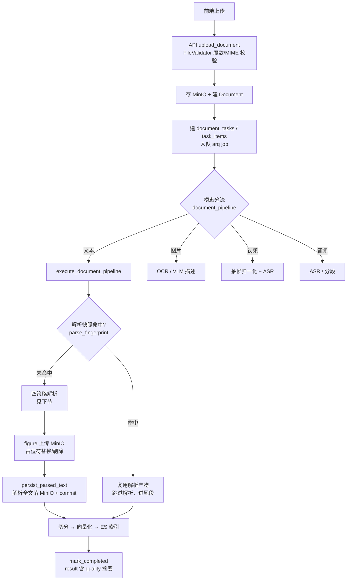

# 文档处理流水线（Document Processing Flow）

> 2026-10-24 重写，对齐解析引擎当前形态：四策略路由 × figure 盐化链 × 三级指纹快照 × 坏文档防御 × 质量报告透出。
> 旧版（2026-07-16）只有模态分流的粗流程图，已被本版整体替换。

## 总览

## 四条解析策略（文本模态）

路由实现在 `document_pipeline.py`（策略解析，未知策略显式拒绝）+ `engines/document/pipeline/document_loader.py`（default/deepdoc 双分支）：

| 策略 | 路径 | 说明 |
|---|---|---|
| `default` | shared readers（`shared/document/readers/`）+ splitter | 朴素线性化读取，无版面/标题治理；metadata 带 `quality`（收集范围受限，见「质量报告」） |
| `deepdoc` | `engines/document/integrations/deepdoc/core/runtime_parser.py`（`DeepDocParser`） | 15 格式解析器；full 模式含 OCR/版面识别；产物经 `_normalize_parse_result` 出口规范化（figure_regions/document_blocks 恒在、region 十键统一）；reading_order 哨兵重切（tagged_rechunk）尊重用户切分配置 |
| `external_ocr` | `media/ocr` connector（外部 OCR 服务） | 扫描件/图片型 PDF；入口有 PDF 前置快检（魔数 + needs_pass） |
| `mineru` | `engines/document/integrations/mineru/client.py`（CLI 子进程） | 外部 MinerU 引擎；入口同款 PDF 前置快检；产物图片契约与 deepdoc figure_regions 同构 |

## 容器递归解析（zip / eml / msg）

企业常见「zip 里一堆文档」「邮件带附件」——容器格式在解析层展开成员逐个递归（成员复用同一同步路由，天然过各自入口守卫），产物按成员标题头拼接、容器级统一切分：

- 展开器：`engines/document/pipeline/nested_archive.py`——guard_office_zip 前置、成员数/解压总量上限（超限拒收整包）、嵌套 zip 深度限制、打包元数据过滤
- figure 合并：成员 region 重编号（`m{序}_` 前缀防跨成员撞名）并以容器盐重签占位符，成员正文旧占位符精确替换——容器文档占位符全部绑定容器内容盐
- 邮件附件提取在 eml/msg 解析器的 `body_and_attachments`（正文与附件一次产出），附件成员走同一限额
- 成员解析失败降级为占位说明，其余成员不受牵连

## figure 契约单一权威

region 基座键集、构造、规范化、占位符兜底读取唯一定义在 `engines/document/contracts.py`（`make_figure_region` / `normalize_figure_regions` / `region_placeholder_of`）；六处组装点与业务层三处消费点全部引用权威——跨层加字段漏透传类断裂（xlsx placeholder 事故）在此收口。PDF 的 region.placeholder 与正文渲染同源传盐（`_build_figure_regions_metadata` 接收 `figure_salt`）。

## figure 盐化占位符链

图片只服务「命中 chunk 后展示配图」，不做 VLM 语义描述。三层分工：

1. **引擎层只插占位符**：`document_model.document_salt(payload)`（sha256 前 12 hex，内容绑定——正文同形串无法伪造合法占位符）+ `figure_placeholder(salt, artifact_id)` → `__FIGURE_URL__{salt}_{artifact_id}__`。同文档同盐，金样/快照/指纹稳定。
2. **业务层替换为短文件名**：`_upload_figure_images_to_minio`（上传门禁 `pdf/xlsx/xls/docx/ppt/pptx/epub`）把 blob 传 MinIO（`{base}_figures/` 目录），`_restore_figure_links` 把占位符替换为 `figure_xxx.png` 短路径；**剥除用精确串匹配**（strip_targets = 解析器占位符全集 − 上传成功集合），上传失败的图片从正文剥除而非残留占位符。上传完成后 region 内 `image_blobs` 清除降内存。
3. **读取端 presign 换签名 URL**：`document_query_service.presign_figure_links`（6 小时时效）在 parsed-text / chunks 端点返回前即时换签；存储侧恒存短路径。旧快照经 `pipeline_snapshots.resolve_figure_short_paths` 兜底补算。

region 契约十键：`artifact_id / placeholder / pages / page_start / bbox / caption / text / member_texts / member_bboxes / image_blobs`。

## 坏文档防御体系

入口守卫矩阵（解析器层，`engines/document/`）：

| 格式 | 魔数/加密守卫 | zip 结构守卫 | XML 实体守卫 |
|---|---|---|---|
| pdf | `_raise_if_encrypted`（needs_pass 拦，owner 密码放行） | — | — |
| docx | OLE 头 → Encrypted；HTML 伪格式 → Mismatched | `guard_office_zip` | `safe_fromstring`（禁 DTD/实体/网络） |
| xlsx | OLE 头 → Encrypted；CSV 走 `decode_text_binary` | 同上 | 同上 |
| pptx | OLE 头 + 伪格式 | 同上 | 同上 |
| epub | 非 PK 头 → Mismatched；`META-INF/encryption.xml` 声明加密非字体资源 → Encrypted（字体混淆放行） | 同上 | 同上（container.xml/OPF/encryption.xml） |
| msg / ofd | OLE 头 / zip 结构守卫 | 同上 / zip 校验 | safe_fromstring |
| txt/csv/md/json | `decode_text_binary`（BOM/utf-16 NUL 门控/编码探测） | — | — |

- `guard_office_zip`：重复条目拒收（POI 5.4.0 语义）+ 解压比 1% 下限（POI ZipSecureFile 同款），OOXML 与 OCF（epub）共用。
- 外部策略（external_ocr/mineru）在交外部服务前经 `_guard_pdf_payload` 快检（`%PDF-` 魔数 + needs_pass），坏文档不白耗外部算力。

## 三级指纹快照与断点续跑

`pipeline_snapshots.py`：parse → split → embedding 三级快照（MinIO 存全量 metadata），指纹链 `parse_fingerprint → split_fingerprint`。配置未变的重跑/续跑跳过已完成阶段；切分配置漂移时放弃旧分块按 full_text 重切（解析产物仍复用）。旧快照的 figure 短路径经 `resolve_figure_short_paths` 兜底。

## 质量报告（metadata["quality"]）

- 引擎层：`deepdoc/core/quality.py` 线程限定 WARNING 收集器（并发解析互不串话，50 条封顶），default 与 deepdoc 全部路径出账 `{parser, warnings, duration_ms, ...}`；default 路径收集范围受限（reader 实际解析在共享线程池，仅事件循环线程告警可收集，如扫描件「文字层为空」提示）。
- 透出链：`extract_parse_metadata_summary`（pipeline_steps.py）→ `_build_completion_result` → `DocumentTask.pipeline_result` → `DocumentResponse.quality`（computed_field）→ 前端文档详情「解析质量」提示位（警告条数 + 悬停明细）。

## 上传格式门禁

- 上传白名单唯一定义：`services/document_file_types.py`（xls/ppt 旧二进制刻意未登记，解析路由支持但上传面收口）。
- figure 上传门禁（七格式）：`document_pipeline.py` `("pdf","xlsx","xls","docx","ppt","pptx","epub")`。

## 关键文件索引

| 职责 | 文件 |
|---|---|
| 管线编排 / 策略路由 / figure 上传替换 | `features/knowledge_space/services/document_pipeline.py` |
| 三级快照 / figure 短路径兜底 | `features/knowledge_space/services/pipeline_snapshots.py` |
| 步骤与 metadata 摘要 | `features/knowledge_space/services/pipeline_steps.py` |
| default/deepdoc 双策略引擎入口 | `engines/document/pipeline/document_loader.py`（`DocumentProcessor.parse_document_result`） |
| deepdoc 格式路由 + 容器递归 + 出口规范化 | `engines/document/integrations/deepdoc/core/runtime_parser.py` |
| figure 契约单一权威（region 构造/规范化/兜底读取） | `engines/document/contracts.py` |
| 容器展开器（zip 递归/限额防御） | `engines/document/pipeline/nested_archive.py` |
| 盐化协议 / UnifiedBlock / Markdown 序列化 | `engines/document/integrations/deepdoc/core/document_model.py` |
| 质量报告收集器 | `engines/document/integrations/deepdoc/core/quality.py` |
| 解析异常族 | `engines/document/exceptions.py`（ParsePayloadError 族） |
| compat 工具（编码/XML/zip 守卫） | `engines/document/integrations/deepdoc/compat/compat.py` |
| 读取端 presign | `features/knowledge_space/services/document_query_service.py` |
| 前端解析结果视图 | `frontend/src/views/space/DocumentDetailView.vue` |
